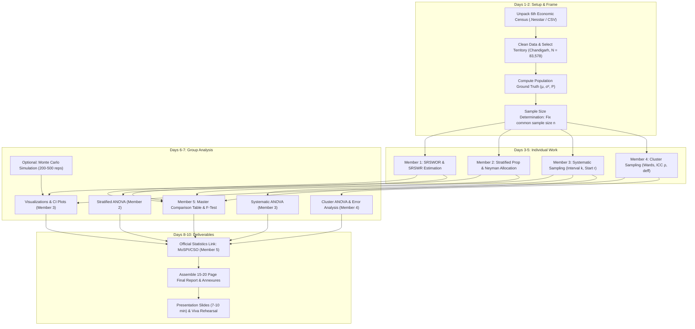

# Sampling Techniques Group Mini-Project: Design, Estimation and Efficiency Comparison

**Course:** Sampling Techniques (50 Marks)  
**Data Source:** Sixth Economic Census (2012–13), Ministry of Statistics and Programme Implementation (MoSPI), Government of India  
**Target Population:** Establishments in Union Territory of Chandigarh (or selected State/UT microdata)  
**Group Size:** 5 Contributors  

---

## 1. Executive Summary & Objective

The objective of this project is to apply, evaluate, and compare four fundamental probability sampling designs—**Simple Random Sampling (SRSWOR/SRSWR)**, **Stratified Random Sampling**, **Systematic Sampling**, and **Single-Stage Cluster Sampling**—on a real, published secondary population dataset. 

Using census-level microdata from the **6th Economic Census of India (2012–13)**, the project estimates:
1. **A numerical variable:** Total persons employed per establishment (`Total_worker`), estimating population mean ($\bar{Y}$) and total ($Y$).
2. **A proportion of interest:** Proportion of female-owned/managed enterprises (`SEX == 2`), estimating population proportion ($P$).

All designs will be evaluated at a common fixed sample size $n$ against known census ground truth parameters to analyze precision, relative efficiency ($RE$), design effects ($deff$), and sources of variance via **One-Way ANOVA** and variance comparison **F-tests**. The project explicitly contextualizes sampling methodology within India's official statistical system.

---

## 2. Dataset Sufficiency Audit

The dataset provided (`DVD_EC_6th_ECONOMIC_CENSUS_2012_v3_lud_23june2016.rar`) contains complete establishment-level microdata across all 36 States and Union Territories of India, along with official enumerator schedules (Schedule 6A), tabulation plans, and administrative code directories.

| # | Project Requirement | Required Criteria | 6th Economic Census Dataset | Audit Status |
|---|---|---|---|---|
| **1** | **Population Size** | $N \ge 500$ units | Contains full census records per state (e.g., Chandigarh: $N = 83,578$; Goa: $N = 96,587$; Sikkim: $N = 37,219$). A single UT or district provides an ideal, closed population ($N \gg 500$). | **Satisfied** |
| **2** | **Data Source** | Published secondary government data with documented provenance | Official MoSPI 6th Economic Census microdata conducted under the *Collection of Statistics Act, 2008*. Tabulation plans, enumerator instructions, and all-India reports are included. | **Satisfied** |
| **3** | **Variable of Study** | 1 numerical variable + 1 proportion ($P$) | **Numerical:** `Total_worker` (Total persons employed).<br>**Proportion:** `SEX == 2` (Female ownership) or `(M_H + F_H) > 0` (Establishments hiring outside labor). | **Satisfied** |
| **4** | **Strata** | Clear basis for $\ge 3$ strata with differing means | **Broad Activity (`BACT`)** (Manufacturing, Retail/Wholesale Trade, Services) or **Ownership Type (`OWN_SHIP_C`)** (Proprietary, Partnership, Company, Cooperative). | **Satisfied** |
| **5** | **Clusters** | Natural clusters with $\ge 20$ clusters in the frame | Hierarchical administrative identifiers: **Wards (`WC`)**, **Tehsils (`TEH`)**, **Town/Village (`T_V`)**, and **Enumeration Blocks (`EB`)**. Chandigarh has 26 municipal wards + rural villages. | **Satisfied** |
| **6** | **Systematic Frame** | Units indexed in a logical order for $k = N/n$ | Listed sequentially by administrative hierarchy: State $\to$ District $\to$ Tehsil/Town $\to$ Ward $\to$ Enumeration Block $\to$ Establishment Serial No. | **Satisfied** |
| **7** | **Uniqueness** | Distinct population and variable pair per group | The combination of UT Chandigarh / selected territory and specific employment & ownership variables guarantees uniqueness. | **Satisfied** |
| **8** | **Official Statistics Link** | 2-page link to an Indian national survey/census | Direct link to MoSPI / CSO, Economic Census operations, National Sample Surveys (NSSO), and the National Enterprise Register. | **Satisfied** |

---

## 3. Five-Contributor Role Division

Each contributor owns one complete sampling design (including mathematical formulas, variance derivations, standard error, 95% confidence intervals, and interpretation), alongside a core group-level operational duty:

```
┌─────────────────────────────────────────────────────────────────────────────────┐
│                           CONTRIBUTOR ALLOCATION MATRIX                         │
├─────────────┬────────────────────────────────────┬──────────────────────────────┤
│ Member      │ Primary Sampling Method            │ Shared / Core Group Duty     │
├─────────────┼────────────────────────────────────┼──────────────────────────────┤
│ Member 1    │ SRSWOR & SRSWR                     │ Data Cleaning & Frame Prep   │
│ Member 2    │ Stratified Sampling                │ Allocation Comparison        │
│ Member 3    │ Systematic Sampling                │ Visuals, Plots & Charts      │
│ Member 4    │ Cluster Sampling                   │ Intraclass Corr. & Errors    │
│ Member 5    │ Synthesis, F-Test & Master Table   │ Official Statistics & Lead   │
└─────────────┴────────────────────────────────────┴──────────────────────────────┘
```

### Contributor 1: Data Engineer & SRS Lead
* **Sampling Method:** Simple Random Sampling Without Replacement (SRSWOR) and With Replacement (SRSWR).
* **Estimation Deliverables:**
  * Sample size determination: derive fixed sample size $n$ based on specified margin of error $d$ and confidence level $1-\alpha$:
    $$n_0 = \frac{z_{\alpha/2}^2 S^2}{d^2}, \quad n = \frac{n_0}{1 + \frac{n_0 - 1}{N}}$$
  * Compute sample mean ($\bar{y}$), population total estimate ($\hat{Y} = N\bar{y}$), sample proportion ($p$), variance estimates:
    $$\widehat{\text{Var}}(\bar{y})_{wor} = \frac{s^2}{n}\left(1 - \frac{n}{N}\right), \quad \widehat{\text{Var}}(\bar{y})_{wr} = \frac{s^2}{n}$$
  * Standard errors ($SE$), 95% confidence intervals, and finite population correction factor ($fpc$).
  * Quantitative efficiency comparison of SRSWOR vs. SRSWR.
* **Shared Duty:** Extract raw microdata, clean missing/invalid records, compute population ground truth parameters ($\mu, \sigma^2, P$), and distribute the cleaned population frame CSV.

### Contributor 2: Stratified Sampling & Allocation Analyst
* **Sampling Method:** Stratified Random Sampling.
* **Estimation Deliverables:**
  * Define $\ge 3$ distinct strata based on Broad Activity (`BACT`) or Ownership (`OWN_SHIP_C`).
  * Compute stratum sizes $N_h$, weights $W_h = N_h/N$, stratum sample means $\bar{y}_h$, and stratum variances $s_h^2$.
  * Compare **Proportional Allocation** ($n_h = n \cdot \frac{N_h}{N}$) vs. **Neyman Optimum Allocation** ($n_h = n \cdot \frac{N_h S_h}{\sum N_h S_h}$).
  * Compute stratified mean ($\bar{y}_{st} = \sum W_h \bar{y}_h$), total ($\hat{Y}_{st} = N\bar{y}_{st}$), proportion ($p_{st}$), estimated variances, SEs, 95% CIs, and gain in precision over SRS.
* **Shared Duty:** Conduct **Stratified One-Way ANOVA** (strata as groups): calculate Between-Strata Sum of Squares ($SSB$), Within-Strata Sum of Squares ($SSW$), $F$-statistic, and $p$-value to verify whether stratum mean differences justify stratification.

### Contributor 3: Systematic Sampling & Visualization Specialist
* **Sampling Method:** Linear Systematic Sampling ($N \approx nk$).
* **Estimation Deliverables:**
  * Calculate sampling interval $k = \lfloor N/n \rfloor$ and select random start $r \in \{1, 2, \dots, k\}$.
  * Compute systematic sample mean ($\bar{y}_{sy}$), total ($\hat{Y}_{sy}$), proportion ($p_{sy}$), variance, SE, and 95% CI.
  * Evaluate the impact of different random starts $r$, comparing efficiency against SRS and Stratified designs.
* **Shared Duty:**
  * Conduct **Systematic One-Way ANOVA** treating the $k$ possible systematic samples as groups to check for ordering effects, monotonic trends, or periodicities.
  * Generate all publication-grade charts: sampling distributions, boxplots across strata/clusters, and confidence interval error-bar comparisons.

### Contributor 4: Cluster Sampling & Intraclass Correlation Analyst
* **Sampling Method:** Single-Stage Cluster Sampling.
* **Estimation Deliverables:**
  * Define $\ge 20$ natural clusters (e.g., Municipal Wards `WC` or Enumeration Blocks `EB`).
  * Sample $n_c$ clusters using SRS, recording cluster sizes $M_i$ and cluster totals $y_i$.
  * Compute unbiased cluster mean ($\bar{y}_{cl}$), total ($\hat{Y}_{cl}$), proportion ($p_{cl}$), variance, and SE.
  * Compute the **Intraclass Correlation Coefficient (ICC, $\rho$)** and **Design Effect ($deff$)**:
    $$\rho \approx \frac{MSB - MSW}{MSB + (\bar{M} - 1)MSW}, \quad deff = 1 + (\bar{M} - 1)\rho$$
  * Quantify loss in efficiency relative to SRS due to positive spatial intra-cluster correlation.
* **Shared Duty:**
  * Conduct **Cluster One-Way ANOVA** using clusters as groups to derive empirical Mean Squares ($MSB, MSW$).
  * Author Section 5: **Sampling and Non-Sampling Errors** (frame coverage, under-reporting of informal units, non-response, recording errors).

### Contributor 5: Synthesis, Official Statistics Link & Report Editor
* **Sampling Method / Synthesis:** Master Comparison & Variance Hypothesis Testing.
* **Estimation Deliverables:**
  * Build the comprehensive **Master Comparison Table**:
    $$\begin{array}{|c|c|c|c|c|c|}
    \hline
    \textbf{Design} & \textbf{Estimate } (\hat{\theta}) & \textbf{SE} & \textbf{95\% CI} & \textbf{Relative Efficiency (RE)} & \textbf{Absolute Error } |\hat{\theta} - \theta| \\
    \hline
    \text{SRSWOR} & \dots & \dots & [\dots, \dots] & 1.000\text{ (Base)} & \dots \\
    \text{SRSWR} & \dots & \dots & [\dots, \dots] & \dots & \dots \\
    \text{Stratified (Prop)} & \dots & \dots & [\dots, \dots] & \dots & \dots \\
    \text{Stratified (Neyman)} & \dots & \dots & [\dots, \dots] & \dots & \dots \\
    \text{Systematic} & \dots & \dots & [\dots, \dots] & \dots & \dots \\
    \text{Cluster} & \dots & \dots & [\dots, \dots] & \dots & \dots \\
    \hline
    \end{array}$$
  * Conduct **F-Test for Equality of Variances** between designs (e.g., SRS vs. Stratified): formulate $H_0: \sigma_1^2 = \sigma_2^2$ vs. $H_1: \sigma_1^2 > \sigma_2^2$, state degrees of freedom, $F_{\text{calc}}$, $p$-value, and conclusion.
  * Formulate final design recommendation considering precision, logistical cost, and operational feasibility.
* **Shared Duty:**
  * Author Section 6: **Link to India's Official Statistical System** (~2 pages on MoSPI, Central Statistics Office, survey operations, frame maintenance, and comparison with NSSO enterprise rounds).
  * Lead report integration (15–20 pages), citation formatting, annexures, and coordinate optional Monte Carlo simulation (200–500 sample iterations).

---

## 4. ANOVA & Variance Comparison Framework

As prescribed by the project specification:

```
┌─────────────────────────────────────────────────────────────────────────────────┐
│                                ANOVA & F-TEST MATRIX                            │
├─────────────┬────────────────────────────────────┬──────────────────────────────┤
│ Design      │ Analysis Structure                 │ What it Tells You            │
├─────────────┼────────────────────────────────────┼──────────────────────────────┤
│ Stratified  │ One-way ANOVA with strata as       │ If strata means differ and   │
│             │ groups. Report SSB, SSW, F, p-val. │ within-strata var is small,  │
│             │                                    │ stratification gains prec.   │
├─────────────┼────────────────────────────────────┼──────────────────────────────┤
│ Cluster     │ One-way ANOVA with clusters as     │ Large between-cluster var    │
│             │ groups. Mean squares estimate ICC. │ means high ICC and lower     │
│             │                                    │ relative efficiency vs SRS.  │
├─────────────┼────────────────────────────────────┼──────────────────────────────┤
│ Systematic  │ One-way ANOVA with k systematic    │ Shows whether random start   │
│             │ samples as groups. Compare within- │ matters and checks for trend │
│             │ sample var to pop variance.        │ or periodic list pattern.    │
├─────────────┼────────────────────────────────────┼──────────────────────────────┤
│ Pairwise    │ F-test on ratio of estimated       │ Whether difference in        │
│ Comparisons │ variances (e.g. SRS vs Stratified).│ precision between two        │
│             │ State H0, H1, F-val, p-val.        │ designs is significant.      │
└─────────────┴────────────────────────────────────┴──────────────────────────────┘
```

---

## 5. Project Roadmap & Milestone Schedule



---

## 6. Report Structure & Marking Scheme Mapping

The final report will be 15–20 pages formatted according to course requirements:

* **Title Page:** Project title, group member names, registration numbers, and explicit individual contribution breakdown.
* **Section 1: Introduction & Survey Design (5 Marks):** Population definition, frame source, variable operationalization, strata and cluster definitions, formal sample size $n$ determination with precision justification.
* **Section 2: Method-wise Analysis — Units 1 to 4 (10 Marks):**
  * *Unit 1:* SRSWOR and SRSWR (Formulas, estimates, standard errors, 95% CIs, finite population correction).
  * *Unit 2:* Stratified Sampling (Proportional vs. Neyman allocation formulas, stratum estimates, overall estimates).
  * *Unit 3:* Systematic Sampling ($k = N/n$, random start $r$, formulas, variance).
  * *Unit 4:* Cluster Sampling (Cluster selection, cluster mean/total formulas, ICC $\rho$ derivation, design effect).
* **Section 3: Method-wise Interpretation (5 Marks):** Precision, efficiency gains, behavior of ICC, and sensitivity to sampling parameters.
* **Section 4: Comparison of Designs, ANOVA & Hypothesis Testing (8 Marks):**
  * Master comparison table.
  * Three One-Way ANOVAs (Stratified, Cluster, Systematic).
  * Variance ratio F-tests with stated hypotheses, test statistics, and Plain-English decisions.
  * Publication-quality visual comparison charts.
  * Final design recommendation based on precision, cost, and logistics.
* **Section 5: Sampling and Non-Sampling Errors (4 Marks):** Frame coverage issues, under-enumeration of informal activities, non-response, measurement and classification errors.
* **Section 6: Link to India's Official Statistical System (4 Marks, ~2 pages):** MoSPI / CSO mandate, Economic Census methodology, collection machinery, reliability, comparison with NSSO unorganized enterprise surveys.
* **Section 7: Conclusion & References:** Synthesis of findings, bibliography including at least 2 official government sources.
* **Annexure:** Cleaned data extract, sampled unit listings under each method, and reproducible R / Python scripts.
* **Presentation & Viva Voce (3 + 7 + 4 = 14 Marks):** 7–10 minute group slide deck covering core findings, ANOVA insights, and individual viva defense.
