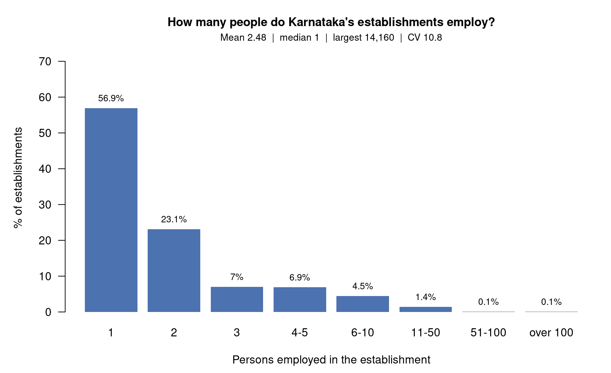
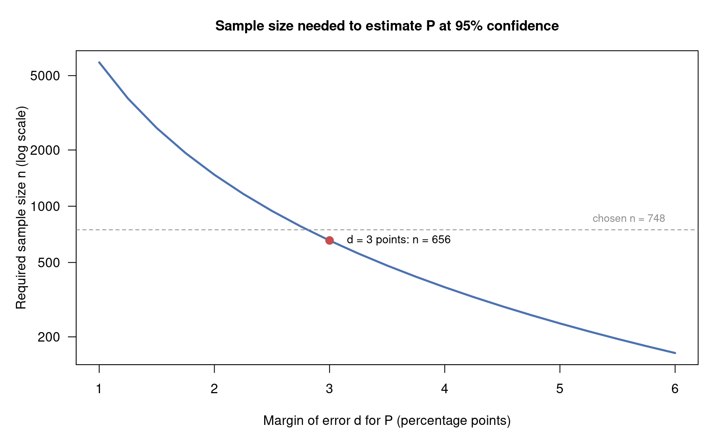
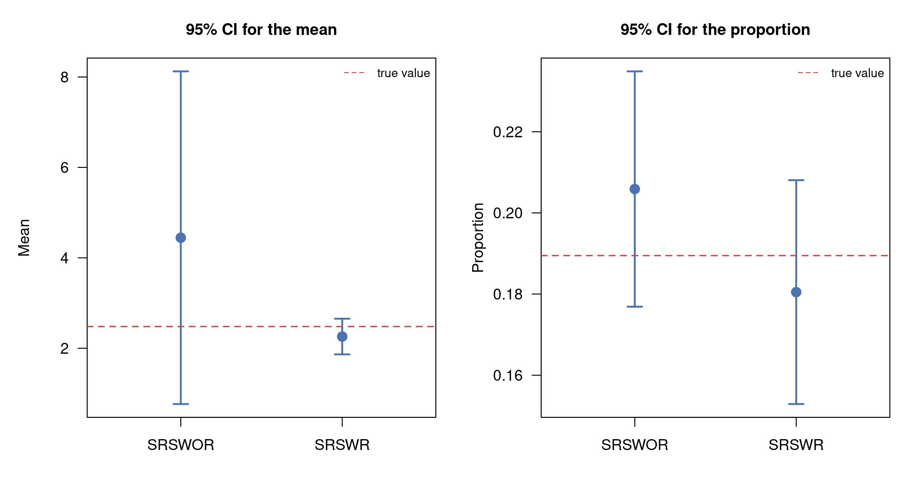

# Unit 1: Frame, sample size, SRSWOR and SRSWR (Member 1)

> Population: all 2,880,548 establishments in Karnataka, Sixth Economic Census 2012-13 (MoSPI).  
> Generated by `analysis/01_srs.R` on 2026-11-21. Re-run the script to update; do not edit by hand.

**Contents**

- [Part A: Data cleaning and the sampling frame](#part-a-data-cleaning-and-the-sampling-frame)
- [Part B: True population values](#part-b-true-population-values)
- [Part C: Sample size for a specified precision](#part-c-sample-size-for-a-specified-precision)
- [Part D: SRSWOR and SRSWR estimates](#part-d-srswor-and-srswr-estimates)
- [Part E: SRSWOR compared with SRSWR](#part-e-srswor-compared-with-srswr)

## Part A: Data cleaning and the sampling frame

**Table 1.1: Data quality checks**

| Check | Problem records |
| :--- | ---: |
| Missing number of workers | 0 |
| Number of workers below 1 | 0 |
| Total workers differs from the sum of its four parts (M_H + F_H + M_NH + F_NH) | 0 |
| Missing owner's sex code | 0 |
| Missing location code (district to enumeration block) | 0 |

No record had to be removed, so the population is the complete census list of 2,880,548 establishments.

**Table 1.2: Establishments reporting 1,000 or more workers**

| Type of ownership | Establishments with 1,000+ workers | Largest reported |
| :--- | ---: | ---: |
| Government / PSU | 7 | 4,500 |
| Private: proprietary (single owner) | 100 | 12,000 |
| Private: partnership | 4 | 1,601 |
| Private: company | 18 | 14,160 |
| Private: co-operative | 1 | 1,400 |
| Private: others | 9 | 2,159 |

**Table 1.3: The eight largest establishments in the data**

| District | Activity | Area | Ownership | Workers | Looks like a recording error? |
| :--- | :--- | :--- | :--- | ---: | :--- |
| Bellary | Primary | Rural | Private: company | 14,160 | possible but plausible |
| Bangalore | Services | Urban | Private: proprietary (single owner) | 12,000 | likely |
| Bangalore Rural | Primary | Rural | Private: proprietary (single owner) | 10,002 | likely |
| Bangalore Rural | Primary | Rural | Private: proprietary (single owner) | 10,002 | likely |
| Udupi | Primary | Rural | Private: proprietary (single owner) | 10,001 | likely |
| Tumkur | Manufacturing | Rural | Private: proprietary (single owner) | 10,001 | likely |
| Tumkur | Manufacturing | Rural | Private: proprietary (single owner) | 10,001 | likely |
| Dakshina Kannada | Manufacturing | Rural | Private: proprietary (single owner) | 10,001 | likely |

**Table 1.4: How much do the suspicious values matter?**

| Data | N | Mean workers | SD of workers | Total workers |
| :--- | ---: | ---: | ---: | ---: |
| All establishments (official data, used in this project) | 2,880,548 | 2.481 | 26.84 | 7,145,885 |
| Without the 7 single-owner establishments reporting 10,000+ workers | 2,880,541 | 2.456 | 21.50 | 7,073,877 |

**Possible recording errors.** 7 proprietary (single-owner) establishments, most in rural areas, report 10,000 or more workers, and 6 of them report exactly 10,001 or 10,002. Repeated values just above 10,000 for private rural businesses look like a placeholder or data-entry code, not real head-counts. We **keep** them because the project must use the official data as published, but they are a clear non-sampling (recording) error. Removing them would change the mean only slightly (2.481 to 2.456) but the SD noticeably (26.8 to 21.5), because the SD is driven by extreme values.

**Table 1.5: Survey design**

| Element | Definition |
| :--- | :--- |
| Population | All establishments in Karnataka, Sixth Economic Census 2012-13 |
| Sampling unit | One establishment |
| Frame | Census list of 2,880,548 establishments |
| Order of the frame (systematic sampling) | District > Tehsil > Town/Village > Ward > Enumeration block |
| Numerical variable Y | Total persons employed in the establishment (TOTAL_WORKER) |
| Proportion P | Share of establishments owned by a woman (SEX = 2) |
| Strata (Member 2) | The 4 revenue divisions: Bengaluru, Mysuru, Belagavi, Kalaburagi |
| Clusters (Member 4) | 105,624 enumeration blocks |
| Sample size | n = 748 for every method (Part C) |

## Part B: True population values

**Table 1.6: True population values (known from the census)**

| Quantity | Value |
| :--- | ---: |
| Number of establishments N | 2,880,548 |
| Mean workers per establishment (Ybar) | 2.4807 |
| Total workers (Y) | 7,145,885 |
| Population variance S^2 | 720.4 |
| Population SD S | 26.840 |
| Coefficient of variation S / Ybar | 10.819 |
| Median workers | 1 |
| Largest establishment (workers) | 14,160 |
| Proportion female-owned P | 0.18948 |
| Number of female-owned establishments | 545,806 |

*Figure 1.1: Most establishments have one worker; a handful employ thousands (extreme right skew)*

**What this means:** over half of all establishments have a single worker, but a few employ thousands. This skew drives every result in the project: it makes the mean much harder to estimate than the proportion.

## Part C: Sample size for a specified precision

**Table 1.7: Sample size determination**

| Step | Value |
| :--- | ---: |
| Required margin of error d for P (95% confidence) | 0.030000 |
| n0 = z^2 PQ / d^2 | 655.5 |
| n = n0 / (1 + (n0 - 1) / N) | 656 |
| Chosen n: smallest divisor of N that is at least n | 748 |
| Sampling interval k = N / n | 3,851 |
| Margin of error actually achieved for P | 0.028080 |
| For comparison: n to estimate the MEAN within 10% | 44,277 |
| For comparison: n to estimate the MEAN within 20% | 11,199 |

**n = 748 is used for every method.** It is fixed by the proportion: a margin of +/-3 percentage points needs 656 establishments. We round up to 748 because 748 x 3,851 = 2,880,548 exactly, which systematic sampling (N = nk) requires. The mean would need 44,277 establishments for 10% precision, which is why the other designs try to do better than SRS.

*Figure 1.2: Required sample size falls quickly as the margin of error is relaxed*

## Part D: SRSWOR and SRSWR estimates

**Table 1.8: SRSWOR and SRSWR estimates with 95% confidence intervals**

| Design | Parameter | Estimate | Variance | SE | 95% CI | True value | Abs. error | CI covers truth | Exact SE |
| :--- | :--- | ---: | ---: | ---: | ---: | ---: | ---: | :--- | ---: |
| SRSWOR | Mean | 4.445 | 3.523 | 1.877 | [0.767, 8.124] | 2.481 | 1.964 | yes | 0.981 |
| SRSWOR | Total | 12,804,575 | 29,228,285,053,102.3 | 5,406,319 | [2,208,384, 23,400,766] | 7,145,885 | 5,658,690 | yes | 2,826,528 |
| SRSWOR | Proportion | 0.2059 | 0.0002188 | 0.0148 | [0.1769, 0.2349] | 0.1895 | 0.0164 | yes | 0.0143 |
| SRSWR | Mean | 2.259 | 0.04048 | 0.201 | [1.865, 2.654] | 2.481 | 0.221 | yes | 0.981 |
| SRSWR | Total | 6,508,190 | 335,873,836,363.6 | 579,546 | [5,372,300, 7,644,080] | 7,145,885 | 637,695 | yes | 2,826,894 |
| SRSWR | Proportion | 0.1805 | 0.0001980 | 0.0141 | [0.1529, 0.2081] | 0.1895 | 0.0090 | yes | 0.0143 |

*Estimate, SE and CI come from the sample. True value and exact SE come from the census, so we can see how close each sample got.*

**Table 1.9: Finite population correction**

| Quantity | Value |
| :--- | ---: |
| Sample size n | 748 |
| Population size N | 2,880,548 |
| Sampling fraction f = n / N | 0.000259673 |
| Finite population correction (1 - f) | 0.999740 |

**Why are the two SEs for the mean so different?** The SRSWOR sample happened to include a large establishment, which inflates s^2; the SRSWR sample did not. The exact SEs (last column) are almost identical. With such skewed data, one sample's SE can be badly misleading.

*Figure 1.3: Both 95% CIs contain the true value; the CIs for the mean differ hugely in width*

## Part E: SRSWOR compared with SRSWR

**Table 1.10: Exact variances of SRSWOR and SRSWR**

| Parameter | Exact variance, SRSWOR | Exact variance, SRSWR | Ratio WR / WOR | Theory (N - 1) / (N - n) |
| :--- | ---: | ---: | ---: | ---: |
| Mean | 0.9628448 | 0.9630945 | 1.000259 | 1.000259 |
| Proportion | 0.0002052640 | 0.0002053172 | 1.000259 | 1.000259 |

**Table 1.11: Probability of selecting a specified establishment**

| Quantity | Value |
| :--- | ---: |
| P(a specified establishment is selected), SRSWOR = n / N | 0.000259673 |
| P(a specified establishment is selected at least once), SRSWR = 1 - (1 - 1/N)^n | 0.000259639 |
| P(a specified establishment is selected at a given draw) = 1 / N (both schemes) | 3.47e-07 |
| Expected distinct establishments in SRSWR = N [1 - (1 - 1/N)^n] | 747.9 |
| Distinct establishments in our SRSWR sample | 748 |

SRSWR's variance is larger by the factor (N - 1)/(N - n) = 1.000259, only 0.026% more. Because n is a tiny fraction of N, selecting the same establishment twice is very unlikely, so the two schemes are practically equivalent. SRSWOR is still preferred, since it is never less precise.

