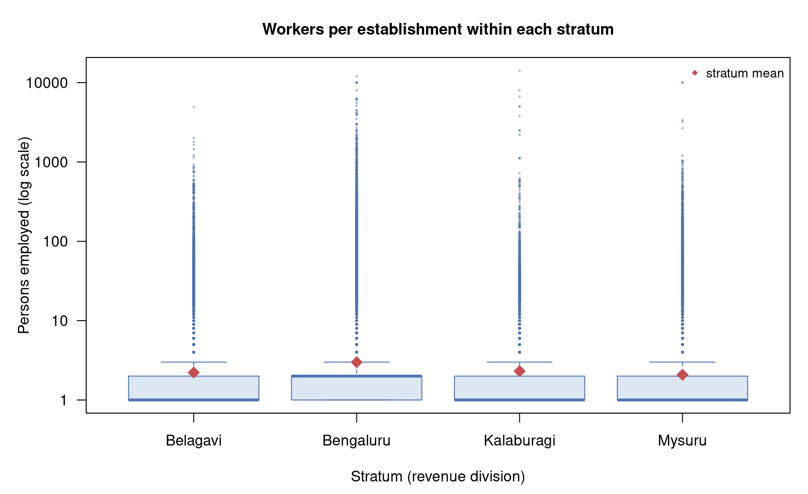
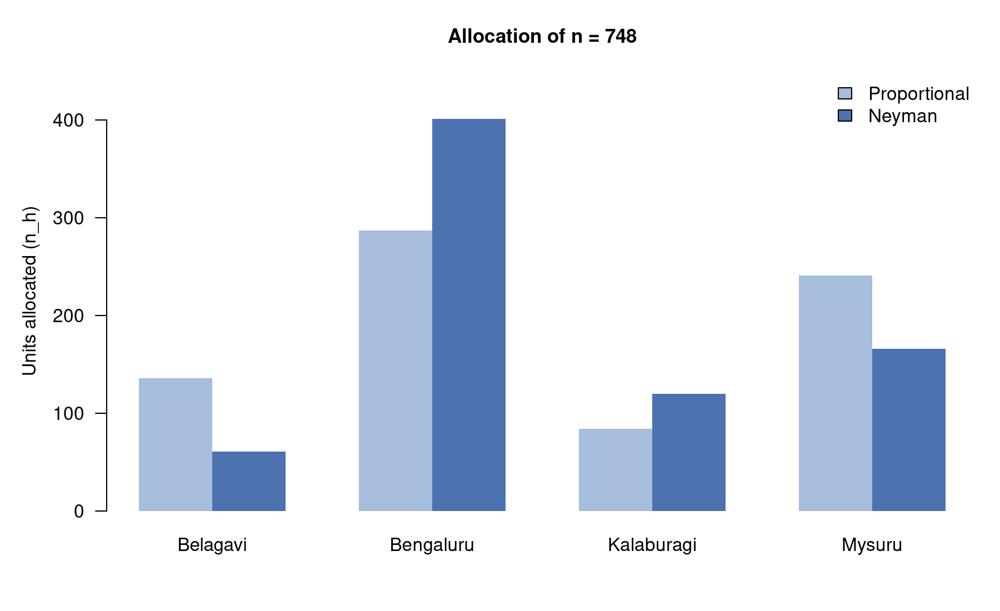
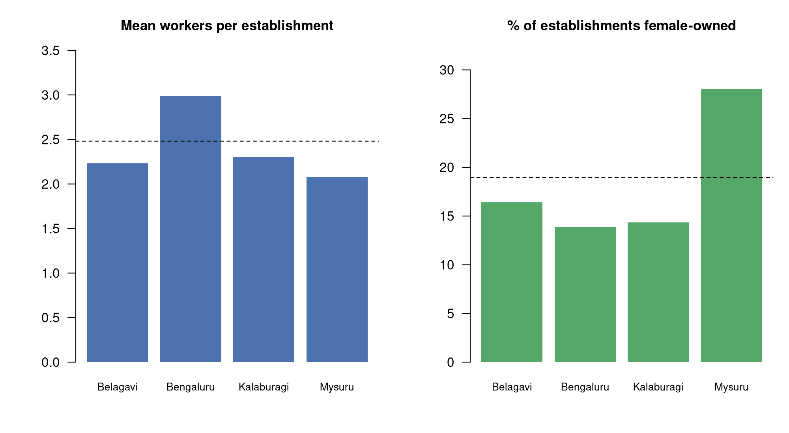

# Unit 2: Stratified random sampling (Member 2)

> Population: all 2,880,548 establishments in Karnataka, Sixth Economic Census 2012-13 (MoSPI).  
> Generated by `analysis/02_stratified.R` on 2026-11-21. Re-run the script to update; do not edit by hand.

**Contents**

- [Part A: The strata](#part-a-the-strata)
- [Part B: Allocating n = 748 to the strata](#part-b-allocating-n--748-to-the-strata)
- [Part C: Estimates from one stratified sample](#part-c-estimates-from-one-stratified-sample)
- [Part D: Gain in precision over SRS](#part-d-gain-in-precision-over-srs)
- [Part E: One-way ANOVA with strata as groups](#part-e-one-way-anova-with-strata-as-groups)
- [Part F: Extra - which basis of stratification is better?](#part-f-extra---which-basis-of-stratification-is-better)

## Part A: The strata

**Table 2.1: The four strata (revenue divisions) in the population**

| Stratum | N_h | W_h = N_h / N | Mean Ybar_h | SD S_h | Proportion P_h |
| :--- | ---: | ---: | ---: | ---: | ---: |
| Belagavi | 522,129 | 0.1813 | 2.230 | 11.20 | 0.1640 |
| Bengaluru | 1,105,955 | 0.3839 | 2.986 | 34.70 | 0.1387 |
| Kalaburagi | 323,664 | 0.1124 | 2.302 | 35.36 | 0.1433 |
| Mysuru | 928,800 | 0.3224 | 2.083 | 17.12 | 0.2803 |

The divisions are Karnataka's official grouping of its 30 districts, so every establishment's stratum is known before sampling. Their means differ a little (2.08 to 2.99), but their **standard deviations differ a lot (11 to 35)**, and so do the proportions of female-owned establishments (14% to 28%).

*Figure 2.1: In every stratum most establishments have 1-2 workers and a few have thousands*

## Part B: Allocating n = 748 to the strata

**Table 2.2: Proportional vs Neyman allocation**

| Stratum | N_h | S_h | N_h x S_h | n_h proportional | n_h Neyman |
| :--- | ---: | ---: | ---: | ---: | ---: |
| Belagavi | 522,129 | 11.20 | 5,849,609.3 | 136 | 61 |
| Bengaluru | 1,105,955 | 34.70 | 38,380,775.0 | 287 | 401 |
| Kalaburagi | 323,664 | 35.36 | 11,446,255.9 | 84 | 120 |
| Mysuru | 928,800 | 17.12 | 15,905,482.7 | 241 | 166 |
| Total | 2,880,548 |  | 71,582,122.9 | 748 | 748 |

Neyman allocation gives **more** units to strata that are large *and* variable (Bengaluru, Kalaburagi) and **fewer** to the more homogeneous ones (Belagavi, Mysuru).

*Figure 2.2: Neyman moves units from homogeneous strata to the most variable ones*

## Part C: Estimates from one stratified sample

**Table 2.3: Stratified estimates with 95% confidence intervals**

| Design | Parameter | Estimate | Variance | SE | 95% CI | True value | Abs. error | CI covers truth | Exact SE |
| :--- | :--- | ---: | ---: | ---: | ---: | ---: | ---: | :--- | ---: |
| Stratified (Proportional) | Mean | 2.159 | 0.01326 | 0.115 | [1.933, 2.385] | 2.481 | 0.322 | no | 0.981 |
| Stratified (Proportional) | Total | 6,219,152 | 110,041,166,035.7 | 331,725 | [5,568,984, 6,869,320] | 7,145,885 | 926,733 | no | 2,826,955 |
| Stratified (Proportional) | Proportion | 0.1979 | 0.0002087 | 0.0144 | [0.1696, 0.2262] | 0.1895 | 0.0084 | yes | 0.0141 |
| Stratified (Neyman) | Mean | 2.421 | 0.1590 | 0.399 | [1.640, 3.203] | 2.481 | 0.059 | yes | 0.908 |
| Stratified (Neyman) | Total | 6,974,819 | 1,319,223,675,549.4 | 1,148,575 | [4,723,654, 9,225,984] | 7,145,885 | 171,066 | yes | 2,616,908 |
| Stratified (Neyman) | Proportion | 0.1878 | 0.0002616 | 0.0162 | [0.1561, 0.2195] | 0.1895 | 0.0017 | yes | 0.0160 |

**Table 2.4: Results inside each stratum (proportional allocation)**

| Stratum | n_h | Sample mean | Sample variance | Sample proportion |
| :--- | ---: | ---: | ---: | ---: |
| Belagavi | 136 | 2.272 | 18.48 | 0.1838 |
| Bengaluru | 287 | 2.220 | 4.619 | 0.1394 |
| Kalaburagi | 84 | 1.845 | 2.181 | 0.1905 |
| Mysuru | 241 | 2.133 | 14.14 | 0.2780 |

**Table 2.5: Results inside each stratum (Neyman allocation)**

| Stratum | n_h | Sample mean | Sample variance | Sample proportion |
| :--- | ---: | ---: | ---: | ---: |
| Belagavi | 61 | 1.705 | 1.945 | 0.1803 |
| Bengaluru | 401 | 3.342 | 421.4 | 0.1322 |
| Kalaburagi | 120 | 2.108 | 5.896 | 0.1333 |
| Mysuru | 166 | 1.837 | 3.967 | 0.2771 |

**Reading Tables 2.4-2.5:** the Neyman sample's Bengaluru stratum caught a very large establishment (sample variance 421), so its SE is larger even though Neyman is the more precise *design*. Single samples of skewed data are noisy; the exact SEs (Table 2.3, last column) show the true precision. fpc: every stratum's sampling fraction f_h = n_h / N_h is below 0.0004, so (1 - f_h) is practically 1.

## Part D: Gain in precision over SRS

**Table 2.6: Exact variances, relative efficiency RE = V(SRS) / V(design), and gain in precision**

| Parameter | V(SRSWOR) | V(proportional) | V(Neyman) | RE proportional | RE Neyman | Gain % proportional | Gain % Neyman |
| :--- | ---: | ---: | ---: | ---: | ---: | ---: | ---: |
| Mean | 0.9628 | 0.9631 | 0.8253 | 0.9997 | 1.167 | -0.03024 | 16.66 |
| Proportion | 0.0002053 | 0.0001999 | 0.0002570 | 1.027 | 0.7987 | 2.670 | -20.13 |

**Why does Neyman make the proportion worse (RE 0.799)?** The allocation was optimised for the *mean*, so it took units away from Mysuru, the stratum where female ownership (28%) varies most. An allocation optimised for P (Belagavi 131, Bengaluru 258, Kalaburagi 77, Mysuru 282) would give RE = 1.041. The best allocation for one variable can be poor for another.

**Table 2.7: Why the gain is what it is (mean)**

| Quantity | Value |
| :--- | ---: |
| Variation of stratum means: sum W_h (Ybar_h - Ybar)^2 | 0.16397 |
| Population variance S^2 | 720.4 |
| Share of S^2 explained by the strata | 0.00022762 |
| (1) V(SRS) - V(prop), by Cochran's formula | 0.00021816 |
|      the same, computed directly | 0.00021816 |
|      effect of rounding n_h to whole numbers | 0.00050937 |
| Variation of stratum SDs: sum W_h (S_h - Sbar)^2 | 102.7 |
| (2) V(prop) - V(Neyman), by Cochran's formula | 0.13730 |
|      the same, computed directly | 0.13730 |
| RE proportional, unrounded allocation | 1.0002 |
| RE Neyman, unrounded allocation | 1.1666 |

**Reading Table 2.7.** (1) The stratum means explain only 0.02% of S^2, so proportional allocation gains almost nothing. The gain is even smaller than the effect of rounding n_h to whole numbers, which is why its RE in Table 2.6 is just below 1. (2) The stratum SDs differ a lot, and that is exactly what Neyman allocation uses, giving about a 17% gain over SRS.

## Part E: One-way ANOVA with strata as groups

H0: all four stratum means are equal. H1: at least one differs. Level of significance: 5%.

**Table 2.8: ANOVA on the whole population**

| Source | df | Sum of squares | Mean square | F | p-value |
| :--- | ---: | ---: | ---: | ---: | ---: |
| Between groups | 3 | 472,336.5 | 157,445.5 | 218.6 | < 0.0001 |
| Within groups | 2,880,544 | 2,074,659,175.8 | 720.2 |  |  |
| Total | 2,880,547 | 2,075,131,512.3 |  |  |  |

With 2.9 million establishments even a tiny difference is 'significant' (p < 0.0001), but the between-strata sum of squares is only 0.023% of the total. Almost all variation is **within** strata.

**Table 2.9: ANOVA on the proportional-allocation sample (n = 748)**

| Source | df | Sum of squares | Mean square | F | p-value |
| :--- | ---: | ---: | ---: | ---: | ---: |
| Between groups | 3 | 11.22 | 3.741 | 0.3766 | 0.7699 |
| Within groups | 744 | 7,390.8 | 9.934 |  |  |
| Total | 747 | 7,402.1 |  |  |  |

F = 0.377, p = 0.7699. **Do not reject H0:** the sample gives no evidence that the stratum means differ.

**Table 2.10: Checking ANOVA's normality assumption**

| Check | Value |
| :--- | ---: |
| Skewness of Y in the population (normal data: 0) | 266.7 |
| Kruskal-Wallis chi-squared on the sample (needs no normality) | 18.28 |
| Kruskal-Wallis p-value | 0.0003852 |

ANOVA assumes roughly normal data with equal variances. Y has skewness 267 and very unequal stratum variances, so the assumption fails badly: a few huge values inflate the within-group mean square and hide real differences. The rank-based Kruskal-Wallis test does not need normality, and it **does** find a difference between strata (p = 0.0004).

## Part F: Extra - which basis of stratification is better?

**Table 2.11: Revenue division vs activity type as the basis of stratification**

| Basis | Strata | RE mean, proportional | RE mean, Neyman | RE proportion, proportional | Range of P_h |
| :--- | ---: | ---: | ---: | ---: | :--- |
| Revenue division | 4 | 0.9997 | 1.167 | 1.027 | 13.9% to 28.0% |
| Activity type | 5 | 1.000 | 1.085 | 1.128 | 4.7% to 42.1% |

Divisions are better for the **mean** (their SDs differ more). Activity type is better for the **proportion**: female ownership ranges from 5% in construction to 42% in manufacturing. The best basis depends on which parameter matters most.

*Figure 2.3: Stratum means differ little; female ownership differs a lot (dashed line = whole state)*

