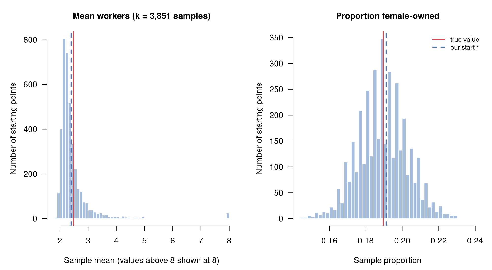
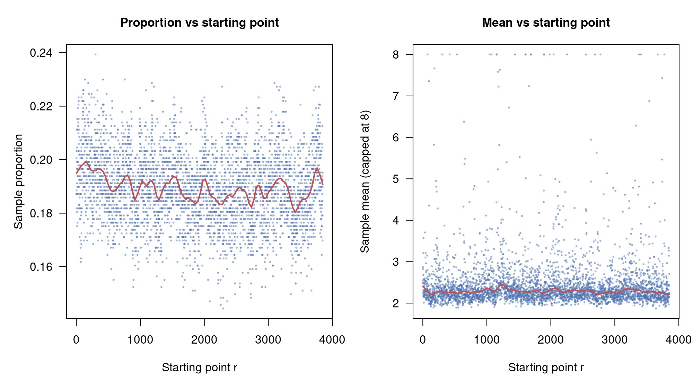
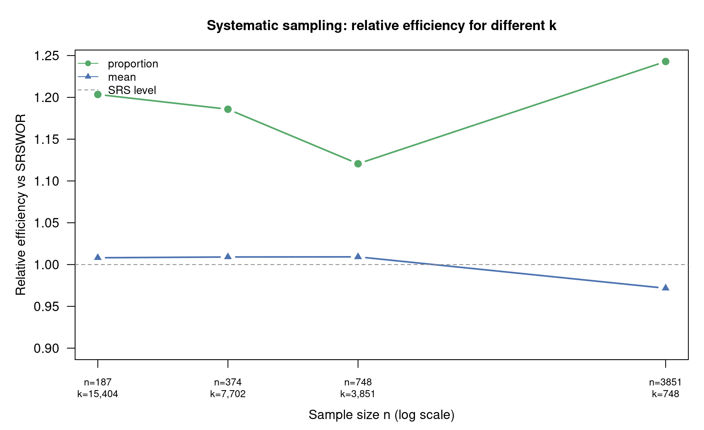

# Unit 3: Systematic sampling (Member 3)

> Population: all 2,880,548 establishments in Karnataka, Sixth Economic Census 2012-13 (MoSPI).  
> Generated by `analysis/03_systematic.R` on 2026-11-21. Re-run the script to update; do not edit by hand.

**Contents**

- [Part A: Set-up](#part-a-set-up)
- [Part B: Estimates from the selected systematic sample](#part-b-estimates-from-the-selected-systematic-sample)
- [Part C: Effect of the starting point - all 3,851 possible samples](#part-c-effect-of-the-starting-point---all-3851-possible-samples)
- [Part D: Comparison with SRS and stratified sampling](#part-d-comparison-with-srs-and-stratified-sampling)
- [Part E: One-way ANOVA with the k systematic samples as groups](#part-e-one-way-anova-with-the-k-systematic-samples-as-groups)
- [Part F: Effect of k (different sample sizes)](#part-f-effect-of-k-different-sample-sizes)
- [Part G: Extra - how the order of the list matters](#part-g-extra---how-the-order-of-the-list-matters)
- [Sources](#sources)

## Part A: Set-up

**Table 3.1: Systematic sample set-up**

| Quantity | Value |
| :--- | ---: |
| Population size N | 2,880,548 |
| Sample size n | 748 |
| Sampling interval k = N / n | 3,851 |
| Random start r (1 to k) | 975 |
| Selected unit numbers | 975, 4,826, 8,677, 12,528, ..., 2,877,672 |
| Number of possible systematic samples (= k) | 3,851 |

The frame is listed by location code (District > Tehsil > Town/Village > Ward > Enumeration block), so one establishment is taken every 3,851 places down the list, starting at a random place r. Because N = n k exactly, every start gives exactly n = 748 units and the sample mean is unbiased.

## Part B: Estimates from the selected systematic sample

**Table 3.2: Systematic sample estimates with 95% confidence intervals**

| Design | Parameter | Estimate | Variance | SE | 95% CI | True value | Abs. error | CI covers truth | Exact SE |
| :--- | :--- | ---: | ---: | ---: | ---: | ---: | ---: | :--- | ---: |
| Systematic | Mean | 2.397 | 0.06152 | 0.248 | [1.911, 2.883] | 2.481 | 0.084 | yes | 0.977 |
| Systematic | Total | 6,904,843 | 510,457,912,587.2 | 714,463 | [5,504,521, 8,305,165] | 7,145,885 | 241,042 | yes | 2,813,593 |
| Systematic | Proportion | 0.1912 | 0.0002069 | 0.0144 | [0.1630, 0.2194] | 0.1895 | 0.0017 | yes | 0.0135 |

A single systematic sample has no unbiased variance estimator, so the SE above uses the usual SRSWOR approximation v = (1 - f) s^2 / n with f = n / N = 0.00026 (fpc = 0.99974). The **exact SE** is computed from all 3,851 possible samples (Part C).

## Part C: Effect of the starting point - all 3,851 possible samples

**Table 3.3: The 3,851 possible systematic samples**

| Summary | Mean workers | Proportion female-owned |
| :--- | ---: | ---: |
| Smallest sample mean | 1.870 | 0.1444 |
| 25th percentile | 2.156 | 0.1805 |
| Median | 2.282 | 0.1898 |
| 75th percentile | 2.487 | 0.1992 |
| Largest sample mean | 21.04 | 0.2393 |
| Average of all k sample means | 2.481 | 0.1895 |
| True value | 2.481 | 0.1895 |
| Exact SE = SD of the k sample means | 0.9768 | 0.01353 |
| % of starts whose 95% CI contains the true value | 61.23 | 96.16 |

The average of all possible sample means equals the true value exactly: the estimator is unbiased. For the proportion, every start gives a similar answer. For the mean, most starts underestimate slightly and a few starts, those that hit a very large establishment, overestimate a lot. Only 61% of the CIs for the mean contain the truth (95% is the target), because the SE formula underestimates when the sample misses the rare giants.

*Figure 3.1: Estimates from every possible starting point (red = true value, blue = our sample)*

*Figure 3.2: No trend or repeating pattern across starting points (red = smoothed average)*

**Trend or periodicity?** If the list had a periodic pattern with period close to k, some starts would always land on high values and Figure 3.2 would show waves. The smoothed line is flat, so the choice of start does not systematically matter; the remaining scatter is random variation between samples.

## Part D: Comparison with SRS and stratified sampling

**Table 3.4: Systematic vs SRS and stratified (exact variances, RE against SRSWOR)**

| Design | Exact variance, mean | Exact variance, proportion | RE mean | RE proportion |
| :--- | ---: | ---: | ---: | ---: |
| SRSWOR | 0.9628 | 0.0002053 | 1 | 1 |
| Stratified (proportional) | 0.9631 | 0.0001999 | 0.9997 | 1.027 |
| Stratified (Neyman) | 0.8253 | 0.0002570 | 1.167 | 0.7987 |
| Systematic | 0.9541 | 0.0001832 | 1.009 | 1.121 |

For the **proportion**, systematic sampling beats both SRS and stratified sampling by division: walking down a geographically ordered list spreads the sample evenly over all 30 districts and their towns, a much finer *implicit stratification* than 4 divisions. For the **mean**, all designs are limited by the few giant establishments.

## Part E: One-way ANOVA with the k systematic samples as groups

H0: the k = 3,851 possible samples have equal means (the start does not matter). H1: they differ.

**Table 3.5: ANOVA, workers per establishment, samples as groups**

| Source | df | Sum of squares | Mean square | F | p-value |
| :--- | ---: | ---: | ---: | ---: | ---: |
| Between groups | 3,850 | 2,748,194.1 | 713.8 | 0.9909 | 0.6534 |
| Within groups | 2,876,697 | 2,072,383,318.1 | 720.4 |  |  |
| Total | 2,880,547 | 2,075,131,512.3 |  |  |  |

**Table 3.6: ANOVA, female ownership (0/1), samples as groups**

| Source | df | Sum of squares | Mean square | F | p-value |
| :--- | ---: | ---: | ---: | ---: | ---: |
| Between groups | 3,850 | 527.6 | 0.1371 | 0.8923 | 1.0000 |
| Within groups | 2,876,697 | 441,859.1 | 0.1536 |  |  |
| Total | 2,880,547 | 442,386.7 |  |  |  |

**Table 3.7: Within-sample variance vs population variance**

| Quantity | Mean workers | Proportion female-owned |
| :--- | ---: | ---: |
| Within-sample variance S^2_wsy (= MSW) | 720.4 | 0.15360 |
| Population variance S^2 | 720.4 | 0.15358 |
| Ratio S^2_wsy / S^2 | 1.0000 | 1.0001 |
| Intraclass correlation within samples rho_w | -1.26e-05 | -0.00014437 |
| V(ybar_sy) from the ANOVA formula | 0.95405 | 0.00018317 |
| V(ybar_sy) from the k sample means | 0.95405 | 0.00018317 |

**Decision, workers:** F = 0.991, p = 0.6534. **Do not reject H0** at the 5% level: the choice of starting point makes no systematic difference. **Decision, female ownership:** F = 0.892, p = 1.0000. **Do not reject H0** at the 5% level: the choice of starting point makes no systematic difference.

**Workers:** F = 0.991 (p = 0.6534) and S^2_wsy ~ S^2, so the systematic samples are about as variable inside as the population: systematic ~ SRS for the mean. **Female ownership:** F = 0.892 (p = 1.0000). S^2_wsy is slightly larger than S^2 and rho_w is negative, which means units inside one systematic sample are *less* alike than random units, because they come from all over the state. That is exactly why systematic beats SRS for the proportion. Normality: Y is extremely skewed, so the F-test for the mean is only approximate; the variance comparison (S^2_wsy vs S^2) does not depend on normality.

## Part F: Effect of k (different sample sizes)

**Table 3.8: Effect of the sampling interval k**

| k | n | RE mean (vs SRSWOR) | RE proportion (vs SRSWOR) | Exact SE of p |
| ---: | ---: | ---: | ---: | ---: |
| 15,404 | 187 | 1.008 | 1.203 | 0.02612 |
| 7,702 | 374 | 1.009 | 1.186 | 0.01861 |
| 3,851 | 748 | 1.009 | 1.121 | 0.01353 |
| 748 | 3,851 | 0.9717 | 1.243 | 0.005661 |

A smaller k means a larger sample and a smaller SE. Against SRS of the **same** size, systematic sampling is better for the proportion at every k (RE 1.12 to 1.24), but not steadily more so as k changes: how much it gains depends on how the interval happens to line up with the geographic pattern of the list. For the mean, RE stays close to 1 for every k.

*Figure 3.3: Relative efficiency of systematic sampling against SRS for four values of k*

## Part G: Extra - how the order of the list matters

**Table 3.9: The same design on differently ordered lists (RE against SRSWOR)**

| List order | RE mean | RE proportion |
| :--- | ---: | ---: |
| Location code (used above) | 1.009 | 1.121 |
| Random order (shuffled list) | 1.001 | 1.009 |
| Sorted by activity type | 0.9580 | 1.283 |

On a **randomly shuffled** list, systematic sampling is just SRS (RE ~ 1). Ordering the list by location or by activity makes it act like a finely stratified sample, and sorting by activity helps the proportion most, because female ownership differs most between activities. The order of the frame is a design choice.

## Sources

- Data: Sixth Economic Census 2012-13, Ministry of Statistics and Programme Implementation (MoSPI), National Data Archive: <https://microdata.gov.in/NADA/index.php/catalog/47>
- MoSPI: <https://mospi.gov.in>
- Code and all results of this project: <https://github.com/AdityaMehta2006/Sampling-mini-project-> (this report: `output/03_systematic/`)
- Data export from the Nesstar file: R package nesstarR, <https://cran.r-universe.dev/nesstarR>

