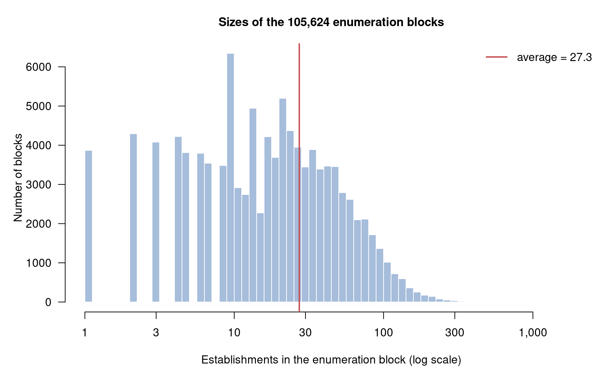
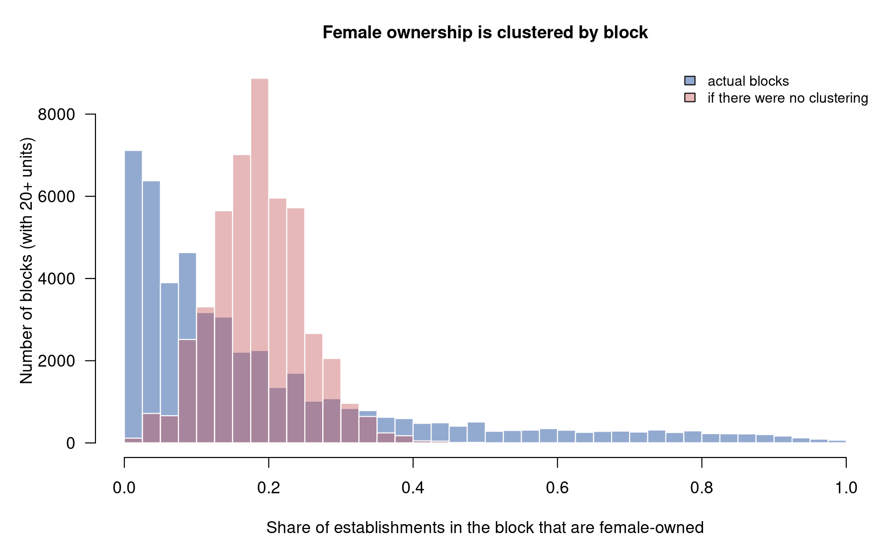
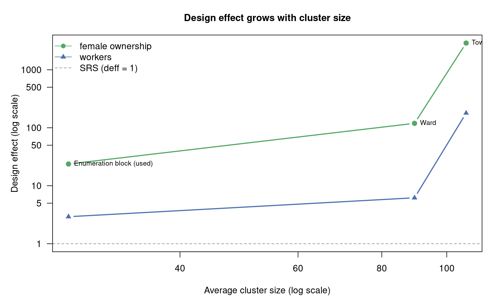

# Unit 4: Cluster sampling (Abhinaba Das)

> Population: all 2,880,548 establishments in Karnataka, Sixth Economic Census 2012-13 (MoSPI).  
> Generated by `analysis/04_cluster.R` on 2026-11-21. Re-run the script to update; do not edit by hand.

**Contents**

- [Part A: The clusters](#part-a-the-clusters)
- [Part B: The selected clusters and the estimates](#part-b-the-selected-clusters-and-the-estimates)
- [Part C: ANOVA with clusters as groups and the intraclass correlation](#part-c-anova-with-clusters-as-groups-and-the-intraclass-correlation)
- [Part D: Design effect and relative efficiency](#part-d-design-effect-and-relative-efficiency)
- [Part E: Extra - bigger clusters, lower efficiency](#part-e-extra---bigger-clusters-lower-efficiency)
- [Part F: Comparison with SRS, stratified and systematic sampling](#part-f-comparison-with-srs-stratified-and-systematic-sampling)
- [Sources](#sources)

## Part A: The clusters

**Table 4.1: Enumeration blocks as clusters**

| Quantity | Value |
| :--- | :--- |
| Cluster | Enumeration block (about one neighbourhood or village part) |
| Number of clusters in the frame N_c | 105,624 |
| Average cluster size Mbar = N / N_c | 27.27 |
| Smallest cluster | 1 |
| Median cluster | 17 |
| Largest cluster | 1,854 |
| Clusters sampled n_c = n / Mbar (rounded) | 27 |
| Expected establishments n_c x Mbar | 736 |

Enumeration blocks are the natural work areas of census enumerators. In single-stage cluster sampling we select 27 blocks at random (SRSWOR) and record **every** establishment in them, about 736 in total, close to n = 748, so the designs are compared at the same sample size.

*Figure 4.1: Cluster sizes vary widely, so the ratio estimator is needed*

## Part B: The selected clusters and the estimates

**Table 4.2: The 27 selected enumeration blocks (cluster code = district-tehsil-town/village-ward-block)**

| Cluster | District | Establishments M_i | Workers y_i | Female-owned a_i | Mean workers y_i / M_i |
| ---: | :--- | ---: | ---: | ---: | ---: |
| 02-001-7021-0024-0074 | Bagalkot | 9 | 9 | 4 | 1 |
| 18-000-7142-0039-0040 | Bangalore | 34 | 94 | 1 | 2.765 |
| 18-000-7142-0036-0057 | Bangalore | 31 | 73 | 1 | 2.355 |
| 18-000-7142-0044-0020 | Bangalore | 6 | 7 | 2 | 1.167 |
| 01-005-7012-0002-0003 | Belgaum | 12 | 19 | 0 | 1.583 |
| 01-001-0063-0000-0328 | Belgaum | 20 | 21 | 4 | 1.050 |
| 11-006-0029-0000-0072 | Bellary | 30 | 57 | 3 | 1.900 |
| 11-006-0048-0000-0133 | Bellary | 3 | 12 | 2 | 4 |
| 04-004-0020-0000-0044 | Bidar | 16 | 31 | 0 | 1.938 |
| 03-004-0106-0000-0423 | Bijapur | 19 | 38 | 0 | 2 |
| 24-004-0069-0000-0379 | Chamarajanagar | 57 | 79 | 28 | 1.386 |
| 24-002-0181-0000-0609 | Chamarajanagar | 3 | 4 | 0 | 1.333 |
| 16-005-0032-0000-0045 | Chikmagalur | 22 | 30 | 3 | 1.364 |
| 12-006-7103-0013-0038 | Chitradurga | 46 | 52 | 23 | 1.130 |
| 12-006-0002-0000-0007 | Chitradurga | 11 | 25 | 1 | 2.273 |
| 12-005-0025-0000-0054 | Chitradurga | 8 | 11 | 2 | 1.375 |
| 21-003-0048-0000-0219 | Dakshina Kannada | 100 | 241 | 10 | 2.410 |
| 25-007-0026-0000-0061 | Gulbarga | 22 | 25 | 4 | 1.136 |
| 20-002-0247-0000-0448 | Hassan | 24 | 26 | 4 | 1.083 |
| 10-006-0089-0000-0230 | Haveri | 38 | 73 | 4 | 1.921 |
| 10-001-0026-0000-0065 | Haveri | 38 | 41 | 9 | 1.079 |
| 23-004-7174-0025-0009 | Mysore | 25 | 71 | 4 | 2.840 |
| 23-007-0013-0000-0052 | Mysore | 25 | 34 | 12 | 1.360 |
| 05-005-0026-0000-0105 | Raichur | 22 | 26 | 2 | 1.182 |
| 14-001-0119-0000-0548 | Shimoga | 8 | 13 | 0 | 1.625 |
| 14-004-0148-0000-0557 | Shimoga | 5 | 13 | 0 | 2.600 |
| 17-004-0005-0000-0010 | Tumkur | 19 | 37 | 8 | 1.947 |

**Table 4.3: Cluster sample estimates with 95% confidence intervals**

| Design | Parameter | Estimate | Variance | SE | 95% CI | True value | Abs. error | CI covers truth | Exact SE |
| :--- | :--- | ---: | ---: | ---: | ---: | ---: | ---: | :--- | ---: |
| Cluster | Mean | 1.779 | 0.01825 | 0.135 | [1.502, 2.057] | 2.481 | 0.701 | no | 1.691 |
| Cluster | Total | 5,125,876 | 151,406,617,497.9 | 389,110 | [4,326,048, 5,925,703] | 7,145,885 | 2,020,009 | no | 4,871,655 |
| Cluster | Proportion | 0.2006 | 0.001475 | 0.0384 | [0.1217, 0.2795] | 0.1895 | 0.0111 | yes | 0.0703 |
| Cluster (unbiased estimator) | Mean | 1.578 | 0.1081 | 0.329 | [0.902, 2.254] | 2.481 | 0.903 | no | 1.811 |
| Cluster (unbiased estimator) | Total | 4,545,744 | 897,131,541,343.4 | 947,170 | [2,598,808, 6,492,680] | 7,145,885 | 2,600,141 | no | 5,215,904 |
| Cluster (unbiased estimator) | Proportion | 0.1779 | 0.002297 | 0.0479 | [0.0794, 0.2764] | 0.1895 | 0.0116 | yes | 0.0827 |

**Ratio estimator** (used for comparisons): mean = sum y_i / sum M_i. **Unbiased estimator**: mean = N_c sum y_i / (n_c N). The unbiased one ignores how many establishments each block has, so its variance depends on the variation in block *totals*, which is huge because sizes vary from 1 to over 1,800. CIs use t with n_c - 1 = 26 degrees of freedom, since only 27 clusters carry information. fpc = 1 - n_c / N_c = 0.99974.

## Part C: ANOVA with clusters as groups and the intraclass correlation

H0: all 105,624 clusters have the same mean (no clustering). H1: cluster means differ. Level of significance: 5%. The mean squares give the intraclass correlation (ICC).

**Table 4.4: ANOVA, workers per establishment, clusters as groups**

| Source | df | Sum of squares | Mean square | F | p-value |
| :--- | ---: | ---: | ---: | ---: | ---: |
| Between groups | 105,623 | 154,386,295.5 | 1,461.7 | 2.112 | < 0.0001 |
| Within groups | 2,774,924 | 1,920,745,216.8 | 692.2 |  |  |
| Total | 2,880,547 | 2,075,131,512.3 |  |  |  |

**Table 4.5: ANOVA, female ownership (0/1), clusters as groups**

| Source | df | Sum of squares | Mean square | F | p-value |
| :--- | ---: | ---: | ---: | ---: | ---: |
| Between groups | 105,623 | 141,007.0 | 1.335 | 12.29 | < 0.0001 |
| Within groups | 2,774,924 | 301,379.8 | 0.1086 |  |  |
| Total | 2,880,547 | 442,386.7 |  |  |  |

**Reject H0 for both variables** (F = 2.11 for workers and 12.29 for female ownership; both p < 0.0001): establishments in the same block are more alike than establishments picked at random, much more so for female ownership. ANOVA assumes normal data; with 2.9 million units the test is robust to this, but for workers the clustering is driven mostly by the few blocks that contain very large employers.

## Part D: Design effect and relative efficiency

**Table 4.6: Intraclass correlation, design effect and relative efficiency**

| Quantity | Mean workers | Proportion female-owned |
| :--- | ---: | ---: |
| MSB (between clusters) | 1,461.7 | 1.335 |
| MSW (within clusters) | 692.2 | 0.1086 |
| m0 (adjusted average cluster size) | 27.27 | 27.27 |
| Intraclass correlation rho | 0.03917 | 0.2928 |
| Design effect by formula 1 + (Mbar - 1) rho | 2.029 | 8.693 |
| Actual design effect V(cluster, ratio) / V(SRS, same n) | 2.924 | 23.72 |
| Relative efficiency vs SRS = 1 / actual deff | 0.3420 | 0.04216 |
| Actual design effect, unbiased estimator | 3.352 | 32.80 |
| Relative efficiency, unbiased estimator | 0.2983 | 0.03049 |

**Female ownership clusters strongly** (rho = 0.293): women-owned businesses are concentrated in particular localities and trades, so a block tells us little that its neighbours do not. With about 27 establishments per block, each sampled block is worth only about 1.1 independent establishments. For workers rho is 0.039. The formula and the actual design effect agree in direction; they differ in size because the formula assumes equal cluster sizes.

*Figure 4.2: Actual blocks are far more spread out than they would be without clustering (high ICC)*

## Part E: Extra - bigger clusters, lower efficiency

**Table 4.7: Larger clusters, larger design effect (same total sample size)**

| Cluster | Clusters | Average size | Clusters for n ~ 748 | ICC, female | Design effect, female | Design effect, workers |
| :--- | ---: | ---: | ---: | ---: | ---: | ---: |
| Enumeration block (used) | 105,624 | 27.27 | 27 | 0.2928 | 23.72 | 2.924 |
| Ward | 32,178 | 89.52 | 8 | 0.2349 | 119.2 | 6.197 |
| Town / village | 26,950 | 106.9 | 7 | 0.2139 | 2,892.5 | 179.0 |

With the total sample fixed at about 748 establishments, larger clusters mean fewer of them. Wards and whole towns/villages give enormous design effects, because a handful of them cannot represent the state; Bengaluru city alone is one 'town' with over 360,000 establishments. Small clusters like enumeration blocks are the only workable choice, and even they are less efficient than SRS.

*Figure 4.3: The larger the clusters, the larger the loss of precision*

## Part F: Comparison with SRS, stratified and systematic sampling

**Table 4.8: Cluster sampling compared with the other designs (RE against SRSWOR)**

| Design | Exact SE, mean | Exact SE, proportion | RE mean | RE proportion |
| :--- | ---: | ---: | ---: | ---: |
| SRSWOR (n = 748) | 0.9812 | 0.01433 | 1.000 | 1.000 |
| Stratified, proportional (n = 748) | 0.9814 | 0.01414 | 1.000 | 1.027 |
| Stratified, Neyman (n = 748) | 0.9085 | 0.01603 | 1.167 | 0.799 |
| Systematic (n = 748) | 0.9768 | 0.01353 | 1.009 | 1.121 |
| Cluster, ratio estimator (27 blocks, about 736 units) | 1.691 | 0.07032 | 0.337 | 0.042 |

Stratified and systematic samples spread the units over the whole state; a cluster sample concentrates them in 27 small areas. Stratification gains when strata differ, and clustering loses when clusters differ, which is the same ANOVA idea seen from opposite sides. Cluster sampling is chosen for **cost**, not precision: 27 compact blocks need far less travel, and only a list of blocks (not of every establishment) is needed.

## Sources

- Data: Sixth Economic Census 2012-13, Ministry of Statistics and Programme Implementation (MoSPI), National Data Archive: <https://microdata.gov.in/NADA/index.php/catalog/47>
- MoSPI: <https://mospi.gov.in>
- Code and all results of this project: <https://github.com/AdityaMehta2006/Sampling-mini-project-> (this report: `output/04_cluster/`)
- Data export from the Nesstar file: R package nesstarR, <https://cran.r-universe.dev/nesstarR>

