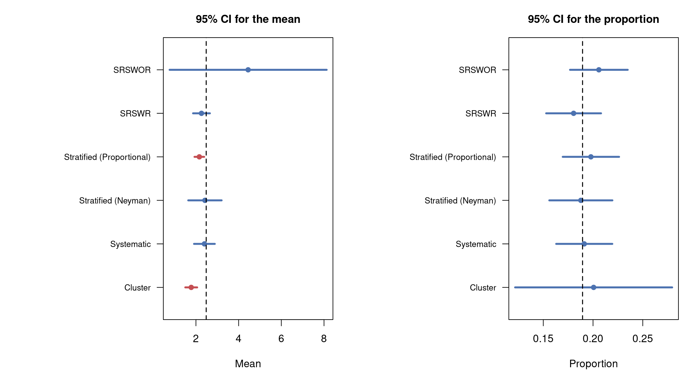
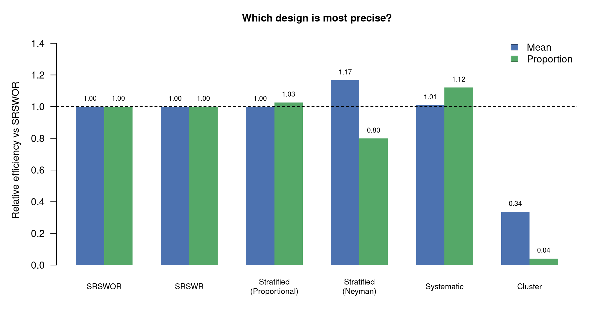
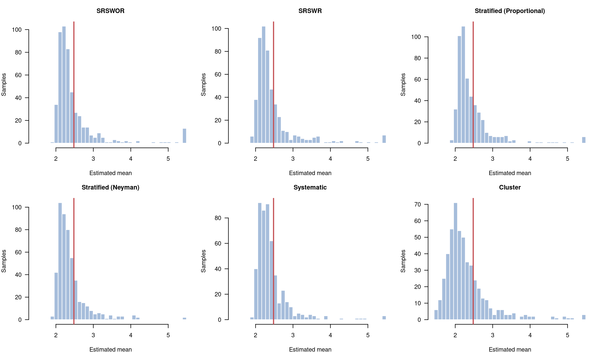
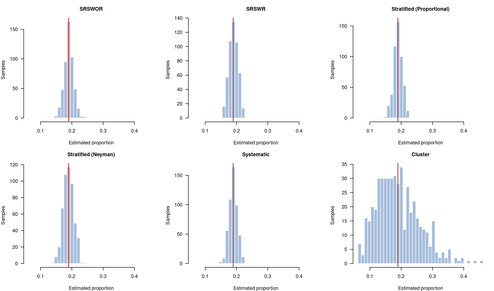

# Comparison of designs, F-tests and simulation (Member 5)

> Population: all 2,880,548 establishments in Karnataka, Sixth Economic Census 2012-13 (MoSPI).  
> Generated by `analysis/05_comparison.R` on 2026-11-21. Re-run the script to update; do not edit by hand.

**Contents**

- [Part A: Master comparison table](#part-a-master-comparison-table)
- [Part B: F-tests comparing the variances of two designs](#part-b-f-tests-comparing-the-variances-of-two-designs)
- [Part C: Monte Carlo simulation - every design repeated 500 times](#part-c-monte-carlo-simulation---every-design-repeated-500-times)
- [Part D: Recommended design](#part-d-recommended-design)
- [Sources](#sources)

## Part A: Master comparison table

One sample of about n = 748 establishments was drawn by every design (Units 1-4). **RE** = exact variance of SRSWOR / exact variance of the design (above 1 = more precise than SRS). Absolute error = |estimate - true value|; the true value is known from the census.

**Table 5.1: Master comparison - every design, estimate, SE, 95% CI, absolute error and RE against SRS**

| Parameter | Design | Estimate | SE | 95% CI | True value | Abs. error | RE vs SRSWOR | CI covers truth |
| :--- | :--- | ---: | ---: | ---: | ---: | ---: | ---: | :--- |
| Mean | SRSWOR | 4.445 | 1.877 | [0.767, 8.124] | 2.481 | 1.964 | 1.000 | yes |
| Mean | SRSWR | 2.259 | 0.201 | [1.865, 2.654] | 2.481 | 0.221 | 1.000 | yes |
| Mean | Stratified (Proportional) | 2.159 | 0.115 | [1.933, 2.385] | 2.481 | 0.322 | 1.000 | no |
| Mean | Stratified (Neyman) | 2.421 | 0.399 | [1.640, 3.203] | 2.481 | 0.059 | 1.167 | yes |
| Mean | Systematic | 2.397 | 0.248 | [1.911, 2.883] | 2.481 | 0.084 | 1.009 | yes |
| Mean | Cluster | 1.779 | 0.135 | [1.502, 2.057] | 2.481 | 0.701 | 0.337 | no |
| Total | SRSWOR | 12,804,575 | 5,406,319 | [2,208,384, 23,400,766] | 7,145,885 | 5,658,690 | 1.000 | yes |
| Total | SRSWR | 6,508,190 | 579,546 | [5,372,300, 7,644,080] | 7,145,885 | 637,695 | 1.000 | yes |
| Total | Stratified (Proportional) | 6,219,152 | 331,725 | [5,568,984, 6,869,320] | 7,145,885 | 926,733 | 1.000 | no |
| Total | Stratified (Neyman) | 6,974,819 | 1,148,575 | [4,723,654, 9,225,984] | 7,145,885 | 171,066 | 1.167 | yes |
| Total | Systematic | 6,904,843 | 714,463 | [5,504,521, 8,305,165] | 7,145,885 | 241,042 | 1.009 | yes |
| Total | Cluster | 5,125,876 | 389,110 | [4,326,048, 5,925,703] | 7,145,885 | 2,020,009 | 0.337 | no |
| Proportion | SRSWOR | 0.2059 | 0.0148 | [0.1769, 0.2349] | 0.1895 | 0.0164 | 1.000 | yes |
| Proportion | SRSWR | 0.1805 | 0.0141 | [0.1529, 0.2081] | 0.1895 | 0.0090 | 1.000 | yes |
| Proportion | Stratified (Proportional) | 0.1979 | 0.0144 | [0.1696, 0.2262] | 0.1895 | 0.0084 | 1.027 | yes |
| Proportion | Stratified (Neyman) | 0.1878 | 0.0162 | [0.1561, 0.2195] | 0.1895 | 0.0017 | 0.799 | yes |
| Proportion | Systematic | 0.1912 | 0.0144 | [0.1630, 0.2194] | 0.1895 | 0.0017 | 1.121 | yes |
| Proportion | Cluster | 0.2006 | 0.0384 | [0.1217, 0.2795] | 0.1895 | 0.0111 | 0.042 | yes |

*Figure 5.1: One sample per design (dashed = true value; red = CI misses the truth)*

*Figure 5.2: Relative efficiency of each design (above the dashed line = better than SRS)*

## Part B: F-tests comparing the variances of two designs

For two designs A and B: H0: the two estimators have equal variance. H1: the one with the larger estimated variance really is less precise. F = larger variance / smaller variance; reject H0 at the 5% level if p < 0.05. The F-test assumes the estimates are roughly normal.

**Table 5.2: F-tests using the estimated variances of the single samples**

| Comparison | Parameter | Based | Larger variance | F | df | p-value | Decision | Same direction as exact variances? |
| :--- | :--- | :--- | :--- | ---: | :--- | ---: | :--- | :--- |
| SRSWOR vs Stratified (Neyman) | Mean | one sample each | SRSWOR | 22.16 | (747, 744) | < 0.0001 | Reject H0: SRSWOR is less precise | yes |
| SRSWOR vs Stratified (Neyman) | Proportion | one sample each | Stratified (Neyman) | 1.196 | (744, 747) | 0.0074 | Reject H0: Stratified (Neyman) is less precise | yes |
| SRSWOR vs Systematic | Mean | one sample each | SRSWOR | 57.26 | (747, 747) | < 0.0001 | Reject H0: SRSWOR is less precise | yes |
| SRSWOR vs Systematic | Proportion | one sample each | SRSWOR | 1.057 | (747, 747) | 0.2231 | Do not reject H0 | yes |
| SRSWOR vs Cluster | Mean | one sample each | SRSWOR | 193.0 | (747, 26) | < 0.0001 | Reject H0: SRSWOR is less precise | NO |
| SRSWOR vs Cluster | Proportion | one sample each | Cluster | 6.740 | (26, 747) | < 0.0001 | Reject H0: Cluster is less precise | yes |

**Caution:** each single-sample variance estimate is itself very noisy for the mean (it depends on whether the sample happened to contain a giant establishment), so these tests can point the wrong way. Part C repeats every design 500 times and tests the variances properly.

## Part C: Monte Carlo simulation - every design repeated 500 times

**Table 5.3: 500 repeated samples per design**

| Parameter | Design | Average estimate | True value | Empirical SE | Exact SE | 95% CIs containing truth (%) | Skewness of estimates |
| :--- | :--- | ---: | ---: | ---: | ---: | ---: | ---: |
| Mean | SRSWOR | 2.573 | 2.481 | 1.263 | 0.9812 | 63.60 | 6.822 |
| Mean | SRSWR | 2.490 | 2.481 | 0.7887 | 0.9814 | 63.60 | 5.563 |
| Mean | Stratified (Proportional) | 2.467 | 2.481 | 0.7302 | 0.9814 | 59.60 | 6.763 |
| Mean | Stratified (Neyman) | 2.423 | 2.481 | 0.9644 | 0.9085 | 60.60 | 16.75 |
| Mean | Systematic | 2.424 | 2.481 | 0.5732 | 0.9768 | 63.60 | 5.971 |
| Mean | Cluster | 2.296 | 2.481 | 0.6706 | 1.691 | 63.60 | 3.732 |
| Proportion | SRSWOR | 0.1905 | 0.1895 | 0.01464 | 0.01433 | 94 | 0.04649 |
| Proportion | SRSWR | 0.1904 | 0.1895 | 0.01421 | 0.01433 | 97.20 | 0.01050 |
| Proportion | Stratified (Proportional) | 0.1899 | 0.1895 | 0.01340 | 0.01414 | 95 | -0.2065 |
| Proportion | Stratified (Neyman) | 0.1895 | 0.1895 | 0.01658 | 0.01603 | 94.40 | 0.03459 |
| Proportion | Systematic | 0.1896 | 0.1895 | 0.01332 | 0.01353 | 96 | 0.03417 |
| Proportion | Cluster | 0.1902 | 0.1895 | 0.06887 | 0.07032 | 80.20 | 0.7145 |

**Reading Table 5.3.** *Proportion:* the average estimate equals the true value and the empirical SE is within 5% of the exact SE for every design, confirming the variance formulas. 95% CIs contain the truth about 95% of the time, except for cluster sampling (80%), whose estimates are skewed and based on only 27 clusters. *Mean:* the empirical SE ranges from 0.4 to 1.3 times the exact SE, and only about 60% of CIs contain the truth. The estimates are extremely skewed: each sample includes a given giant establishment with probability n/N = 1 in 3,851, so 500 repetitions are far too few for the spread of the estimates to settle down. **For the mean, the exact variances in Table 5.1 are the reliable comparison.**

**Table 5.4: F-tests using the variances of the 500 repeated estimates**

| Comparison | Parameter | Based | Larger variance | F | df | p-value | Decision | Same direction as exact variances? |
| :--- | :--- | :--- | :--- | ---: | :--- | ---: | :--- | :--- |
| SRSWOR vs Stratified (Neyman) | Mean | 500 repeated samples | SRSWOR | 1.715 | (499, 499) | < 0.0001 | Reject H0: SRSWOR is less precise | yes |
| SRSWOR vs Stratified (Neyman) | Proportion | 500 repeated samples | Stratified (Neyman) | 1.283 | (499, 499) | 0.0027 | Reject H0: Stratified (Neyman) is less precise | yes |
| SRSWOR vs Systematic | Mean | 500 repeated samples | SRSWOR | 4.854 | (499, 499) | < 0.0001 | Reject H0: SRSWOR is less precise | yes |
| SRSWOR vs Systematic | Proportion | 500 repeated samples | SRSWOR | 1.208 | (499, 499) | 0.0174 | Reject H0: SRSWOR is less precise | yes |
| SRSWOR vs Cluster | Mean | 500 repeated samples | SRSWOR | 3.546 | (499, 499) | < 0.0001 | Reject H0: SRSWOR is less precise | NO |
| SRSWOR vs Cluster | Proportion | 500 repeated samples | Cluster | 22.14 | (499, 499) | < 0.0001 | Reject H0: Cluster is less precise | yes |

**Normality and what to trust.** The proportion's estimates are close to normal (skewness near 0), and every F-test for the proportion agrees with the exact variances: Neyman allocation (optimised for the mean) is less precise for P, systematic is more precise, and cluster sampling is far less precise. The mean's estimates are strongly right-skewed, which violates the F-test's assumption; some of its tests even point the **wrong way** (last column). This is a direct demonstration of why the normality assumption matters.

*Figure 5.3: 500 estimates of the mean from each design (top 1% shown at the right edge); red = true value*

*Figure 5.4: 500 estimates of the proportion from each design; red = true value*

## Part D: Recommended design

**Table 5.5: Precision, cost and convenience of each design**

| Design | RE, mean | RE, proportion | Cost and convenience |
| :--- | ---: | ---: | :--- |
| SRSWOR | 1.000 | 1.000 | Needs the full list; units scattered across the state (high travel cost) |
| SRSWR | 1.000 | 1.000 | As SRSWOR, and may visit the same unit twice |
| Stratified (Proportional) | 1.000 | 1.027 | Needs the division of each unit (known); 4 separate random samples |
| Stratified (Neyman) | 1.167 | 0.799 | Needs stratum SDs from a previous census; 4 separate random samples |
| Systematic | 1.009 | 1.121 | One random number; easy to carry out on an ordered list; spread evenly over the state |
| Cluster | 0.337 | 0.042 | Cheapest fieldwork: 27 compact areas, no full list needed, only lists of blocks |

**Recommendation: systematic sampling from the census list ordered by location.** It is the most precise design for the proportion (RE 1.12) and as good as SRS for the mean (RE 1.01). It needs only one random number, and walking down a geographically ordered list spreads the sample over every district. If the mean number of workers were the main target, Neyman-allocated stratified sampling (best for the mean, RE 1.17) would be preferred. Cluster sampling is cheapest in the field but loses most of its precision (RE 0.04 for the proportion) because businesses in the same block are alike.

## Sources

- Data: Sixth Economic Census 2012-13, Ministry of Statistics and Programme Implementation (MoSPI), National Data Archive: <https://microdata.gov.in/NADA/index.php/catalog/47>
- MoSPI: <https://mospi.gov.in>
- Code and all results of this project: <https://github.com/AdityaMehta2006/Sampling-mini-project-> (this report: `output/05_comparison/`)
- Data export from the Nesstar file: R package nesstarR, <https://cran.r-universe.dev/nesstarR>

